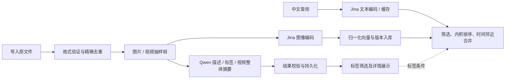

# ObjectLift 算法与数据处理说明

更新：2026-11-12；对照代码版本 f717c0f。本文描述实际实现，不将方案候选写成已完成。模型运行命令见 [MODELS](MODELS.md)，性能证据见 [第一轮报告](OPTIMIZATION_ROUND_1.md)，质量评测计划见 [评测方案](OPTIMIZATION_EVALUATION.md)。

## 1. 算法边界及代码索引

项目没有训练或微调自有模型。Pillow/FFmpeg 提供基础媒体运算，Jina/Qwen 提供预训练推理能力；项目实现输入校验、预处理衔接、向量检索、标签规则、时间邻近去重与资源调度。

| 模块 | 实现入口 | 性质和当前状态 |
| --- | --- | --- |
| 方向、缩放、裁剪、透明合成 | services/image_io.py | 传统图像处理，调用 Pillow |
| 透明前景校验 | services/foreground.py | 输入验证，不是抠图或分割 |
| 处理快照及裁剪流程 | services/workspace.py、ui/page.py | 保留的旧图片工作台功能，当前 /workbench 不是此入口 |
| 文件去重及缩略图 | services/library.py | SHA-256 精确去重、托管存储，当前素材库已使用 |
| 视频抽样 | services/video.py | 时间间隔采样，调用 FFmpeg；不是镜头检测 |
| 图文编码 | services/embeddings.py | Jina CLIP v2 本地图像/文本编码 |
| 向量搜索及结果合并 | services/indexing.py | 归一化、矩阵内积、排序、近邻时间抑制 |
| 描述和标签 | services/caption_worker.py、services/captions.py | Qwen2-VL 推理、JSON/标签规则校验与持久化 |
| 批次模型复用 | services/caption_session.py、CaptionService.describe_many | 工程性能优化，不改变模型或排序算法 |

两条模型路径可以分别运行；当前描述文本不参与向量计算和排序，不是检索前必须先生成描述。

## 2. 图像预处理

### 2.1 解码与方向、尺寸

`load_image` 验证真实 JPEG/PNG 格式和静态单帧，默认像素数不超过 40,000,000；拒绝损坏文件及解压炸弹警告。用 `ImageOps.exif_transpose` 修正方向，有 alpha 或调色板透明信息时转 RGBA，否则转 RGB。

默认最长边 M=2048，使用 LANCZOS 等比缩小、不放大。理想缩放比例为 `s=min(1,M/W,M/H)`；最终整数尺寸由 Pillow 确定。后续坐标属于方向校正和缩放后的图像坐标系。

注意调用点差异：素材入库设置 `max_side=40_000_000`，在像素限制内保留校正后的尺寸用于元数据；原文件字节不重编码。预览另缩到 512×512 范围。Jina 对图片使用原文件经默认 2048 预处理后编码，视频则使用已抽取的预览帧；并非所有链路都直接输入 512 图。

### 2.2 手动裁剪与边距

输入框 `(x1,y1,x2,y2)`，右/下边界排除。要求四个有限值、正宽高，且与图片有交集；边距比例 p 在 [0,1]，默认 0.1。

令 `dx=(x2-x1)*p`、`dy=(y2-y1)*p`，实际边界为：

- 左：`max(0,floor(x1-dx))`；上：`max(0,floor(y1-dy))`。
- 右：`min(W,ceil(x2+dx))`；下：`min(H,ceil(y2+dy))`。

例如 100×80 图上的框 (10,10,50,40)，p=0.1，得到 (6,7,54,43)，裁剪尺寸 48×36。该模块不自动预测目标框，当前素材库没有自动裁剪流水线。

### 2.3 透明合成与前景验证

`detection_rgb` 将 RGBA 合成到白底并转 RGB。对归一化 alpha a，每通道相当于 `C=a*F+(1-a)*255`，返回副本，不改变原图；Jina 图像输入使用此步骤。函数名不代表当前存在目标检测模型。

`validate_foreground` 要求宽高至少 2 像素、有透明信息、alpha 非全零，返回 RGBA 副本。完全不透明的 RGBA 也能通过，因此它只验证格式和非空内容，不证明分割质量。自动抠图、目标检测、3D 重建均不在当前实现范围。

## 3. 精确去重与视频抽帧

`Library` 按 1 MiB 块读取文件，累计大小并计算 SHA-256；图片限制 20 MiB，视频限制 300 MiB（界面简写 MB）。相同摘要判重复；相同画面经重编码、裁剪或改变元数据后可能不再重复。这不是感知哈希或语义相似去重。

视频额外验证 MP4 容器、首视频流 H.264、时长 `0 < duration <= 240 秒`、像素面积不超 40,000,000。FFmpeg 选择首帧，此后选择距离上次已选帧至少 5 秒的帧，使用 `showinfo` 的实际 `pts_time`，四舍五入成毫秒入库。输出边长在 512 范围内保留比例，帧数上限 49；单次 FFmpeg/ffprobe 调用超时 180 秒。

采样不是严格每 5.000 秒一帧，也不保证覆盖视频末帧；可变帧率以实际时间戳为准。短事件可能被跳过，当前没有镜头切分、运动检测、关键事件检测、音轨识别或长视频自动分段。

## 4. 图文向量与检索

### 4.1 编码与合法性

`JinaEncoder` 本地加载 jinaai/jina-clip-v2，默认 revision 为 `e10d47f5691d0454a0fb5d13f46f2199b74cb436`，可由环境变量覆盖。校验 manifest 的 revision 以及其中列举的代码/配置 SHA-256；这不是对全部权重逐文件做完整性验证。模型使用本地自定义代码，准备脚本负责本地化依赖。

默认 CUDA 可用时 FP16，否则 CPU FP32；可配置设备。向量转换为一维 little-endian float32，拒绝空向量、NaN/Inf 和零范数，然后计算 `v_hat=v/||v||2`。写库时同时保存维度、模型 ID、revision；维度由实际输出决定。

### 4.2 搜索流程

1. 空白查询直接返回空结果；索引、描述或其他查询持有锁时返回忙碌提示。
2. 从 SQLite 选择未在回收站、向量 ready、模型 ID/revision 匹配的视觉单元，应用媒体类型和标签条件。标签属于命中视觉单元，而非整个视频所有帧的标签集合。
3. 查询缓存键为 `(model_id,revision,query.strip())`，最多 64 条，按最近使用更新，超量淘汰最旧项；缓存存查询向量，不是搜索结果。
4. 新查询用文本编码器生成并归一化。候选向量维度不一致则跳过；读取向量再次归一化。无效向量可能触发错误，当前不是逐个容错跳过。
5. 组装 N×d 矩阵 V，计算 `scores=V @ q_hat`。双方为单位向量时，内积即余弦相似度；它不是概率，不可读作“80%准确”。
6. 按分数降序遍历；同一视频中，若与任一已选命中的时间差严格小于 10,000ms，则抑制该命中；差值恰为 10 秒可同时保留。最后返回前 K 个。

时间抑制是贪心去重，不推断事件边界，也不是只允许一个视频返回一条。当前无最低相似度拒绝阈值、重排序模型、描述融合或 ANN 索引；无相关素材时仍可能返回近似结果。

N 个候选、d 维向量：读向量/矩阵计算约 O(Nd)，排序 O(N log N)，当前逐项时间抑制最坏 O(N²)，向量矩阵约 O(Nd) 内存。查询缓存省去编码，不能省去每次读库和组矩阵。性能优化应使用实际规模实测。

## 5. 描述生成与标签规则

当前使用 Qwen/Qwen2-VL-2B-Instruct，下载脚本首次解析版本后写入 revision.json，完成后生成 ready.json；本机实测固定版本为 `895c3a49bc3fa70a340399125c650a463535e71c`。代码中的下载默认行为不是无条件硬编码该版本。

- 图片：使用该素材预览图，经 `ImageOps.pad` 保持比例补黑边到 224×224，原生 image 输入；不是 Jina 的白底合成路径。
- 视频：从已有抽样帧中选最多 16 个，索引为 `round(i*(n-1)/max(1,k-1))`，包含已有采样序列两端，并非原视频末帧；顺序输入原生 video。只有一帧时复制为两帧供视频输入使用。
- Processor 参数 min_pixels=56²、max_pixels=224²；模型 CUDA FP16/CPU FP32，SDPA，`do_sample=False`，`max_new_tokens=256`。不进行训练或微调。
- 图片提示词要求中文描述和最多五个标签，视频提示词要求基于可见画面的中文摘要，均不含音轨。文本长度/五标签是提示约束，当前代码没有硬性截断描述或标签到该数量，不能宣称完整强制执行。
- 图片从输出首个 `{` 到最后一个 `}` 提取 JSON；服务验证 caption 为非空字符串。标签限人物、动物、建筑、自然、室内、交通、食物、物品，去空白、按原顺序去重，未知字符串丢弃；缺失、空或全未知归“未分类”，非字符串数组元素报错。
- 图片结果存 visual_items/tags；视频整体摘要存 video_descriptions，不自动复制到每个视频帧。标签参与过滤，描述文本目前只展示，不参与向量排序。

JSON/白名单校验只能约束结构，无法证明语义正确。模型仍会遗漏或幻觉，必须与原图对照评测。

## 6. 批量推理和失败恢复

单项 `describe` 获取互斥锁，卸载 Jina，调用独立 Qwen 进程，单项超时 600 秒，结束退出。批量 `describe_many` 在整个批次持锁且只卸载一次 Jina，`CaptionSession` 通过 stdin 发送请求/输出文件路径；工作进程首项加载模型并逐项复用。

每项输出写临时文件再替换，父进程约每 50ms 检查结果，校验后逐项保存。失败项标 failed 并保留旧描述，正常的后续项可继续；超时或进程异常时关闭工作进程，下一项可重新创建。批次结束关闭会话释放该进程的资源，不代表整机 GPU 占用归零。

UI 批量入口只选图片描述 pending/failed，跳过 ready；不自动覆盖所有已有描述。进度约每秒更新；未实现用户取消按钮、持久任务队列或导入后的自动处理流水线。启动恢复将中断阶段置为可重试状态，不能称为自动恢复到原推理位置。

这次优化是生命周期复用，提示词和生成参数未变。固定三图三轮的中位耗时 38.48→22.29 秒，降低 42.1%，9 项输出一致；不是质量提升，也不是完整规模基准。详见原始报告。

## 7. 验证矩阵、缺口及质量指标

| 范围 | 对应测试/证据 | 结论边界 |
| --- | --- | --- |
| 解码、裁剪、透明合成、前景 | tests/test_images.py、test_workspace.py | 生成样例规则验证，不是目标检测准确率 |
| 哈希、入库与恢复 | tests/test_library.py、test_trash.py | 业务一致性，不验证语义相似去重 |
| 时间采样 | tests/test_video.py、scripts/smoke_video.py | 有真实 H.264 抽帧记录，不等于浏览器 seek 全验收 |
| 向量规则/缓存/筛选 | tests/test_indexing.py、scripts/smoke_embeddings.py | 替身规则测试与真实纯色图冒烟分别记录 |
| 描述持久化与批处理 | tests/test_captions.py、scripts/benchmark_captions.py | 29项全量回归及小样本性能已记录，语义质量未评分 |

质量评测尚未执行：用 COCO128 人工物体标注构造固定客观中文查询和相关图片集合，另建组合/主观查询人工判定、描述错误表及视频时间区间标注。COCO 检测标签不能充当自由描述的完整真值，未标注对象也不能直接认定不存在。

定义：前五张至少找到一张的查询比例（Hit@5）= 命中查询数/有标注相关图片的查询数。按2026-11-12用户确认，不再用Precision@5评分；改为辅助观察“找对张数/min(5,库内正确图片数)”，逐查询计算后平均，明确不是全库召回率，也不是模型置信度。无标注相关图片的查询单列不计分。旧JSON保留历史指标用于追溯，不进入当前验收结论。描述仍按事实错误、遗漏、推断和标签错误人工评测。

保留开发查询与未参与调优的测试查询，避免反复针对同一套题调参。现有 Top-5 80% 是待验收目标，不是实测结果；算法优化需同时报告准确性、速度、显存及失败案例。
